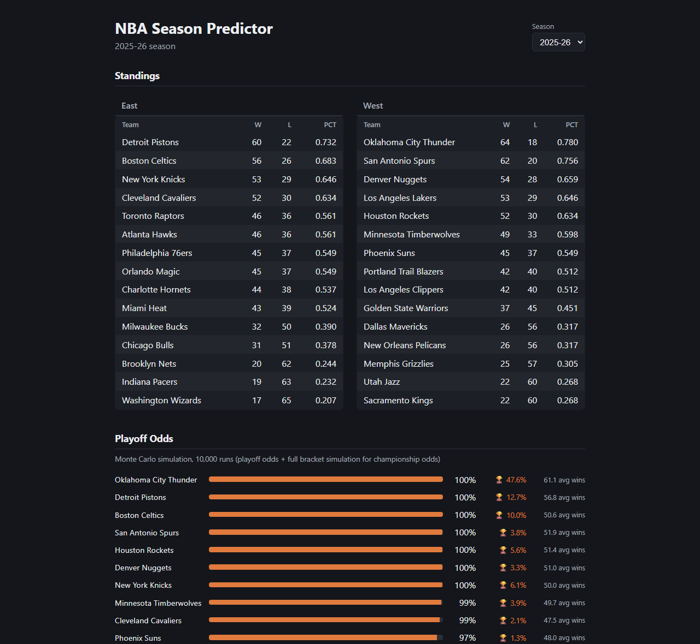
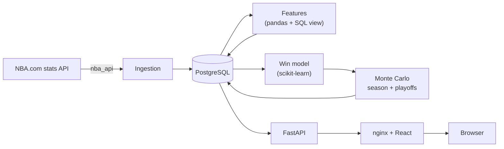

# NBA Season Predictor

Predicts NBA game winners and simulates the rest of a season to project standings, playoff odds, and championship odds, using five seasons of real NBA.com data.

[](https://github.com/lmdelros/nba-season-predictor/actions/workflows/ci.yml)



## Highlights

- **68.6% of games predicted correctly on a season the model never saw** (all 1,230 games of 2025-26), 13.2 points better than always picking the home team, with lower log loss and Brier score than every baseline. [Results](docs/results.md)
- **Found and fixed data leakage in the season simulator.** The original backtest scored future games with features built from their real results, which inflated its accuracy (0.976 rank correlation). After freezing every feature at the cutoff date it measured 0.921, then improved to 0.949. [Backtest](docs/backtest.md)
- **Leakage is guarded by tests.** Every feature, the simulator, and a SQL window-function view are tested by rewriting future results and asserting nothing earlier changes; each test was checked by injecting the bug on purpose.
- **Runs with one command.** Docker Compose starts PostgreSQL, a FastAPI service, and a React app served by nginx; a second command loads real data.
- **50 automated tests in CI** on every push: Python and database tests against a real PostgreSQL instance, frontend tests and build, and a smoke test of the whole stack through nginx.

## Overview

The project pulls game results and box scores from NBA.com, stores them in PostgreSQL, and turns them into per-team features such as season-to-date point margin and rest days. A logistic regression model estimates each game's home-win probability. A Monte Carlo simulation then plays out the rest of the season 10,000 times, seeds a best-of-seven playoff bracket from each simulated season, and counts how often each team makes the playoffs and wins the title. The results are served by a REST API and shown in a React web app.

Every reported number comes from a script in this repository that anyone can rerun, and the win model and the simulation are both compared with simple baselines, so a claim like "+13.2 points" has a reference point. Projections are evaluated as backtests on completed seasons: the simulation pretends it is February 1, 2026, and its projections are compared with how the 2025-26 season actually ended.



## Tech stack

| Tool | What it does here |
|---|---|
| **Python 3.12** | Data pipeline, models, simulation, and API |
| **nba_api** | Downloads game logs, box scores, and award history from NBA.com |
| **PostgreSQL 16** | Stores 13 tables of games, box scores, features, predictions, and simulation runs; a SQL view computes each team's season-to-date point margin with window functions |
| **pandas, NumPy** | Feature engineering and simulation |
| **scikit-learn** | Logistic regression win model, gradient boosting comparison, linear regression margin model, k-means player clustering |
| **FastAPI** | REST API for standings, predictions, and simulation results |
| **React 19 + Vite** | Web app showing standings and playoff odds |
| **nginx** | Serves the built React app and forwards `/api` requests to FastAPI |
| **Docker Compose** | Runs PostgreSQL, a schema migration step, the API, and the web app together |
| **pytest, Vitest** | Python, database, API, and frontend tests |
| **GitHub Actions** | Runs lint, all tests, and a full-stack smoke test on every push |

## Getting started

### Requirements

- [Docker Desktop](https://www.docker.com/products/docker-desktop/) (or Docker Engine with Compose v2)
- Git
- Free ports 5433 (PostgreSQL), 8000 (API), and 8080 (web app)
- Internet access to NBA.com for loading data

### Run it

1. Clone the repository:

   ```bash
   git clone https://github.com/lmdelros/nba-season-predictor.git
   cd nba-season-predictor
   ```

2. Build and start the app (PostgreSQL, the API, and the web app):

   ```bash
   docker compose up -d --wait
   ```

3. Load one season of real data. This downloads the 2025-26 season from NBA.com, builds features, trains the model, and runs 10,000 simulations. It usually takes about a minute, depending on how quickly NBA.com responds.

   ```bash
   docker compose run --rm pipeline python -m scripts.seed_demo
   ```

4. Open **http://localhost:8080**.

To stop everything, run `docker compose down`. Your data stays in a Docker volume; add `-v` to delete it too.

No environment file is needed: the Compose file sets every setting, and the database password is a local-only default.

## Usage

The web app shows the final standings for each loaded season and, for seasons with a simulation run, each team's playoff and championship odds as projected from the simulation's cutoff date.

The API is available directly on port 8000, with interactive documentation at **http://localhost:8000/docs**, and through the web app under `/api`:

```bash
curl "http://localhost:8080/api/simulations?season=2025-26"
```

Each team's entry looks like this (your `batch_id`, `run_at`, and odds will differ with the data you loaded):

```json
{
  "team_id": 1610612760,
  "abbreviation": "OKC",
  "full_name": "Oklahoma City Thunder",
  "batch_id": "69580a28-b99a-4791-92e4-36ef9c2d52ae",
  "run_at": "2026-10-30T19:18:59.847019Z",
  "num_simulations": 10000,
  "avg_wins": 61.14,
  "playoff_pct": 1.0,
  "championship_pct": 0.4763
}
```

Other endpoints: `/health`, `/seasons`, `/teams`, `/standings?season=`, and `/predictions?season=`.

To run individual pipeline steps, load more seasons, retrain models, or reproduce the evaluations, see [docs/pipeline.md](docs/pipeline.md).

## Results

All numbers below are produced by scripts in `evaluation/` and `models/`; each linked page shows the exact command.

**Win model:** trained on 2021-22 through 2024-25, tested once on all 1,230 games of 2025-26. ([docs/results.md](docs/results.md))

| Method | Accuracy | Log loss | Brier |
|---|---|---|---|
| Always pick the home team | 55.4% | 0.687 | 0.247 |
| Pick the team with the better record so far | 66.9% | 0.631 | 0.220 |
| Gradient boosting, same features | 65.1% | 0.628 | 0.218 |
| **Logistic regression (this project)** | **68.6%** | **0.608** | **0.209** |

Log loss and Brier score measure how good the predicted probabilities are; lower is better for both. The model's six features (season-to-date point margin, rest days, and back-to-backs for each team) were chosen by validating on earlier seasons only. ([docs/feature_selection.md](docs/feature_selection.md))

**Season simulation:** projecting 2025-26 from February 1, 2026. ([docs/backtest.md](docs/backtest.md))

| Method | Rank correlation with final standings | Mean error (wins) |
|---|---|---|
| Keep each team's February 1 win % for all 82 games | 0.943 | 3.54 |
| **Monte Carlo simulation (this project)** | **0.949** | 4.02 |

The simulation orders teams slightly better than the naive projection and found 14 of the 16 playoff teams, but its win totals are less accurate (see Limitations).

**Point-margin model:** a linear regression on the original 13 features predicts the final margin within 12.11 points on average, against 14.32 for always predicting the average margin (2024-25, last 20% of the season, 262 games).

**Award models (MVP, DPOY, ROY, MIP):** for each award, a logistic regression ranks every season's 20 most likely candidates, trained on 2010-11 through 2021-22. On the three held-out seasons (2022-23 through 2024-25) its top pick was the real winner 7 times out of 12: MVP 2 of 3, Defensive Player of the Year 1 of 3, Rookie of the Year 2 of 3, and Most Improved Player 2 of 3. Three seasons per award is a small sample, and the DPOY and MIP candidate lists leave out some real winners, which limits those two models. ([docs/pipeline.md](docs/pipeline.md#award-models))

## Running tests

Python tests (the database and API tests use the Compose database on port 5433 and are skipped if it is not running):

```bash
python -m venv .venv
source .venv/bin/activate        # Windows PowerShell: .venv\Scripts\Activate.ps1
pip install -r requirements.txt -r requirements-dev.txt
docker compose up -d --wait
ruff check .
python -m pytest
```

Frontend tests, lint, and build:

```bash
cd frontend
npm ci
npm run lint
npm test
npm run build
```

## Limitations

- **Simulated win totals are compressed toward .500.** The simulation ranks teams well, but in the 2025-26 backtest it projected the ten best teams 3.9 wins too low and the ten worst 4.7 wins too high on average, so its win-total error (4.02) is higher than simply extrapolating each team's record (3.54).
- **Backtests only.** Every projection is evaluated on a completed season with a pretend cutoff date; no season was in progress while this was built.
- **The play-in tournament is not modeled.** The top eight teams in each conference by wins make the playoffs.
- **The data download depends on NBA.com,** which can be slow and is reported to block requests from cloud servers.
- **Applying `db/schema.sql` adds missing tables but not new columns** to tables that already exist.
- **Player clusters are labeled by hand** after each fit, since k-means numbers clusters arbitrarily.

## Project status

Actively developed as a portfolio project. Planned next: a hosted deployment.

## Contributing

Issues and suggestions are welcome. For larger changes, please open an issue first to discuss the idea.

## Author

**Luis del Rosario**, [GitHub](https://github.com/lmdelros)
