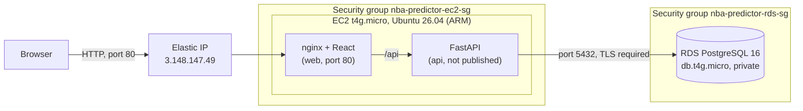

# Deployment on AWS

The app runs on AWS at **http://3.148.147.49**: an EC2 server runs the Docker stack, and an RDS PostgreSQL database stores the data. This page describes the setup, why each piece is configured the way it is, the checks that confirm it is secure, and how to deploy, update, and tear it down.

## Architecture



Everything runs in **us-east-2 (Ohio)**, in the account's default VPC.

| Resource | Configuration | Why |
|---|---|---|
| EC2 instance `nba-predictor-server` | `t4g.micro` (2 vCPU, 1 GB RAM, ARM/Graviton), Ubuntu Server 26.04 LTS | Smallest instance that runs the stack; ARM costs less than the equivalent x86 `t3.micro`, and every image in the project supports ARM |
| CPU credit mode | Standard | Burstable instances in Unlimited mode can bill extra for sustained CPU use; Standard throttles instead |
| Storage | 12 GB gp3 | Room for the Docker images and a 2 GB swap file |
| Swap | 2 GB file, created at first boot | The 1 GB of RAM can run out while building the images |
| Elastic IP | `3.148.147.49` | Keeps the address fixed when the server is stopped and started |
| RDS instance `nba-predictor-db` | PostgreSQL 16, `db.t4g.micro`, 20 GB, single-AZ, encrypted, not publicly accessible | Managed backups and patching; storage autoscaling and Performance Insights are turned off to keep costs fixed |
| Containers | `migrate`, `api`, `web` from [docker-compose.prod.yml](../docker-compose.prod.yml) | The same images as local development, pointed at RDS |

## Security design

- **Only the website is public.** The EC2 security group allows HTTP (80) from anywhere. SSH (22) is allowed only from the maintainer's IP address and from AWS's EC2 Instance Connect service (browser-based SSH). The API container has no published port; nginx reaches it over Docker's internal network.
- **The database is private.** RDS has *Publicly accessible* set to No, so its address resolves to a private IP inside the VPC. Its security group allows port 5432 only from the EC2 security group, not from any IP range, so only the app server can connect even with the password.
- **Database connections are encrypted.** The production Compose file sets `PGSSLMODE=require` for the migration and the API, so a connection without TLS is refused instead of sending the password in plain text.
- **No secrets in the repository.** The database password lives only in a `.env` file on the server (permissions `600`, ignored by Git). [.env.example](../.env.example) lists the settings with placeholder values.
- **Containers run as unprivileged users.** The API image runs as a non-root user.
- **Account access.** Daily work uses an IAM user with MFA, not the root user; the root user also has MFA. The server's SSH key was generated on the maintainer's laptop and only its public half was uploaded to AWS.

### Evidence

Checks run on November 2, 2026, from a laptop outside AWS unless noted:

| Check | Result |
|---|---|
| `curl http://3.148.147.49/` | HTTP 200, page title "NBA Season Predictor" |
| `curl http://3.148.147.49/api/health` | `{"status":"ok"}` |
| API port 8000 from the internet | No response; the port is not published |
| RDS endpoint DNS lookup | Resolves to a private address (172.31.x.x) |
| TCP connection to RDS port 5432 | Times out |
| Database session from the server (`pg_stat_ssl`) | `encrypted: true (TLSv1.3)` |
| Production stack against a local test database without TLS (local test, not on AWS) | Refused: "server does not support SSL, but SSL was required" |
| Row counts after loading data into RDS | Identical to the source database (6,150 games, 131,291 player box scores, 59 award winners) |

## Deploy from scratch

Settings in the AWS console, all in the same region:

1. **Security groups.** Create one for the server (HTTP 80 from anywhere, SSH 22 from your IP) and one for the database (PostgreSQL 5432 from the server's security group only).
2. **RDS.** Create a PostgreSQL 16 `db.t4g.micro` instance with 20 GB storage, single-AZ, *Publicly accessible: No*, storage autoscaling off, the database security group, and initial database name `nba_predictor`.
3. **EC2.** Launch Ubuntu Server (64-bit Arm) on `t4g.micro` with a 12 GB gp3 volume, the server security group, an SSH key pair, *Credit specification: Standard*, and the contents of [deploy/ec2-user-data.sh](../deploy/ec2-user-data.sh) as user data. The script adds swap and installs Docker with the Compose plugin; wait for `cloud-init status` to report `done`.
4. **Elastic IP.** Allocate one and associate it with the instance.

Then on the server (`ssh -i <key> ubuntu@<elastic-ip>`):

```bash
git clone https://github.com/lmdelros/nba-season-predictor.git
cd nba-season-predictor
cp .env.example .env
chmod 600 .env
nano .env        # set DB_HOST to the RDS endpoint, DB_USER, and DB_PASSWORD
docker compose -f docker-compose.prod.yml up -d --build --wait
```

The `migrate` service creates the tables and views in RDS before the API starts.

### Loading data

NBA.com is reported to block requests from cloud servers, so data is loaded on a local machine and copied to RDS. With the local stack running:

```bash
# On the local machine: back up the local database and copy it to the server
docker exec nba-predictor-db pg_dump -U nba -d nba_predictor -Fc --no-owner --no-privileges > nba.dump
scp -i <key> nba.dump ubuntu@<elastic-ip>:~/nba.dump

# On the server: replace the RDS contents with the backup, all or nothing
cd ~/nba-season-predictor
docker compose -f docker-compose.prod.yml run --rm -v ~/nba.dump:/backup.dump:ro migrate \
  pg_restore --clean --if-exists --no-owner --no-privileges --single-transaction --exit-on-error \
  -d nba_predictor /backup.dump
```

`--clean` replaces every table in RDS, so take an RDS snapshot first. `--single-transaction` with `--exit-on-error` rolls the whole restore back if any step fails.

## Updating

After pushing changes to GitHub:

```bash
ssh -i <key> ubuntu@<elastic-ip>
cd ~/nba-season-predictor
git pull
docker compose -f docker-compose.prod.yml up -d --build --wait
```

Images whose code did not change rebuild in seconds from Docker's cache, and Compose restarts only the containers whose image changed. The migration re-applies the schema, which is safe to re-run.

## Costs

The account uses AWS's credit-based free plan, so these resources draw down credits rather than free-tier hours. Approximate monthly cost when running continuously (check the [AWS Pricing Calculator](https://calculator.aws/) for current prices):

| Resource | Approximate cost per month |
|---|---|
| EC2 `t4g.micro` ($0.0084 per hour) | $6 |
| EC2 storage, 12 GB gp3 | $1 |
| Elastic IP (public IPv4 address) | $3.60 |
| RDS `db.t4g.micro` and 20 GB storage | $14 to $16 |
| **Total** | **about $25** |

## Teardown

To stop all charges:

1. **EC2:** terminate `nba-predictor-server`. Its volume is deleted with it.
2. **Elastic IP:** release it (*Elastic IPs > Actions > Release*). An Elastic IP is billed whether or not it is attached.
3. **RDS:** delete `nba-predictor-db`. Optionally keep a final snapshot to restore later.
4. **Snapshots:** delete any manual RDS snapshots that are no longer needed.
5. **Key pairs and security groups:** delete them; both are free, but removing them keeps the account tidy.

Update the live demo link in the README in the same change.

## History

The first deployment, in August 2026, ran the Streamlit dashboard directly on an Amazon Linux `t3.micro` with Python installed on the host, served on port 8501, against the same RDS database. In November 2026 it was replaced by the Docker stack above: the React app behind nginx on port 80, the FastAPI service with no public port, and containers built from the same images that CI tests.
